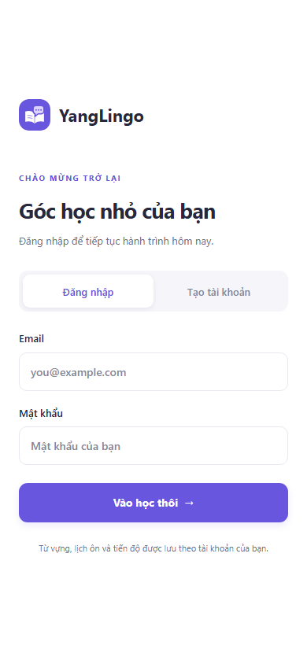
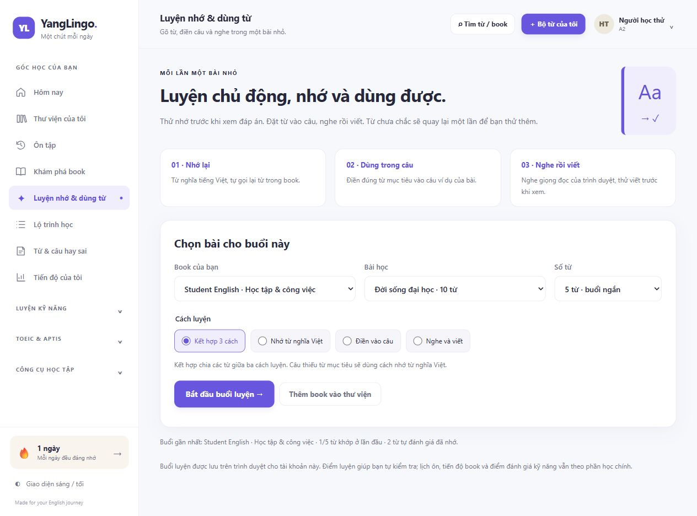

# YangLingo


Ứng dụng học tiếng Anh bằng flashcard, ôn tập cách quãng và các bài luyện ngắn.
Backend dùng PHP/MySQL; giao diện dùng JavaScript và CSS thuần.

[Mở bản triển khai](https://yangcute.helioho.st/)

Trang chính trả HTTP 200 và tiêu đề YangLingo khi kiểm tra ngày 03/11/2026.
Kết quả này chỉ xác nhận trang vào; chưa xác nhận toàn bộ luồng đăng nhập và học
trên hosting. [Phạm vi kiểm tra](docs/portfolio-verification.md) ghi riêng những gì đã chạy.

<details>
<summary>Ảnh trang vào trên hosting, desktop và mobile</summary>




</details>



## Chức năng

- Quản lý book, bài học, bộ từ và thư mục.
- Ôn flashcard theo SRS, lưu tiến độ riêng cho từng tài khoản.
- Luyện nhớ từ, điền từ vào câu, nghe và viết lại.
- Ghi chú, tự đặt câu và tìm kiếm trong sổ tay học tập.
- Lập kế hoạch ôn theo thẻ đến hạn, độ chính xác và lỗi thường gặp.
- Luyện TOEIC, Aptis, nghe và nói; lưu lịch sử làm bài.
- Nhập TXT, CSV, XLSX, DOCX và quản lý học liệu qua tài khoản quản trị.
- Gia sư và tạo flashcard qua OpenRouter khi được cấu hình.

Các book có sẵn gồm Everyday English, Student English, Daily Essentials,
English for Web và học liệu TOEIC. Lịch ôn dùng quy tắc xác định từ tiến độ học.
Điểm tự đánh giá khi luyện nói/viết không phải điểm thi chính thức.

## Cài đặt cục bộ

Cần PHP 8.0 trở lên, MySQL hoặc MariaDB; bật `pdo_mysql` và `mbstring`.

1. Tạo database trống.
2. Sao chép `config.example.php` thành `config.local.php`.
   Điền thông tin database và `app_url` là `http://127.0.0.1:8080`.
   Để `openrouter_api_key` trống nếu chỉ dùng phần học và ôn tập.
3. Chạy máy chủ phát triển:

   ```bash
   php -S 127.0.0.1:8080
   ```

4. Mở `http://127.0.0.1:8080/setup.php` và tạo tài khoản quản trị.
5. Mở trang chính, đăng nhập và chọn một book trong Thư viện.

Trình cài tạo schema, chạy migration và seed theo thứ tự, rồi khóa thiết lập bằng
`storage/installed.lock`. Khi cập nhật một hệ thống đã có dữ liệu, giữ nguyên
`config.local.php` và lịch sử migration. Xem [hướng dẫn migration](docs/migrations.md).

## Cấu trúc

- `index.php` và `assets/`: giao diện, điều hướng và bài luyện.
- `api.php`: API JSON, xác thực, CSRF và kiểm tra quyền.
- `lib/`: truy vấn dữ liệu, SRS, importer và các dịch vụ học tập.
- `database/`: schema, migration và học liệu dùng chung.
- `assets/flashbooks/`: book đóng gói dạng JSON/CSV.
- `templates/`: các mẫu nhập dữ liệu.
- `tests/`: kiểm thử PHP và JavaScript.
- `docs/`: tài liệu thiết kế, dữ liệu, cài đặt và kiểm thử.

## Kiểm tra

Một số bài kiểm tra không cần database:

```bash
php tests/srs_test.php
php tests/adaptive_test.php
php tests/importer_test.php
php tests/migration_integrity_test.php
node --check assets/app.js
node tests/learning_ux_test.cjs
node tests/pronunciation_ux_test.cjs
node tests/notebook_navigation_test.cjs
node tests/practice_state_test.cjs
```

Các bài kiểm thử có tạo dữ liệu cần database thử riêng.
Cấu hình và danh sách lệnh nằm trong [tài liệu kiểm thử](docs/testing.md).
API kiểm tra tài khoản sở hữu dữ liệu; nội dung người dùng được escape khi hiển thị.
Xem thêm [SECURITY.md](SECURITY.md).

## Tài liệu

- [Tổng quan](docs/overview.md)
- [Kiến trúc](docs/architecture.md)
- [Lịch ôn và kế hoạch học](docs/adaptive-scheduling.md)
- [Nhập dữ liệu](docs/imports.md)
- [Triển khai](docs/deployment.md)
- [Sổ tay](docs/notebook.md)
- [Nguồn và giấy phép học liệu](docs/content-licenses.md)

## Giấy phép

Mã dự án và logo dùng [MIT License](LICENSE).
Học liệu PDF, bảng từ vựng và dữ liệu phiên âm có nguồn và điều kiện sử dụng riêng
trong [tài liệu học liệu](docs/content-licenses.md) và [trang nguồn phiên âm](pronunciation-sources.html).
